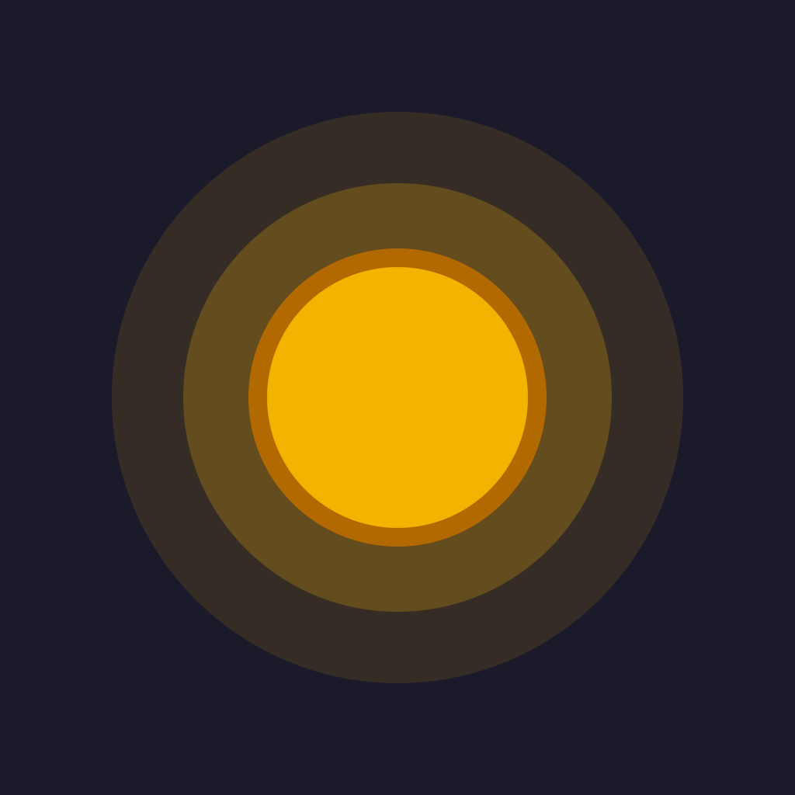
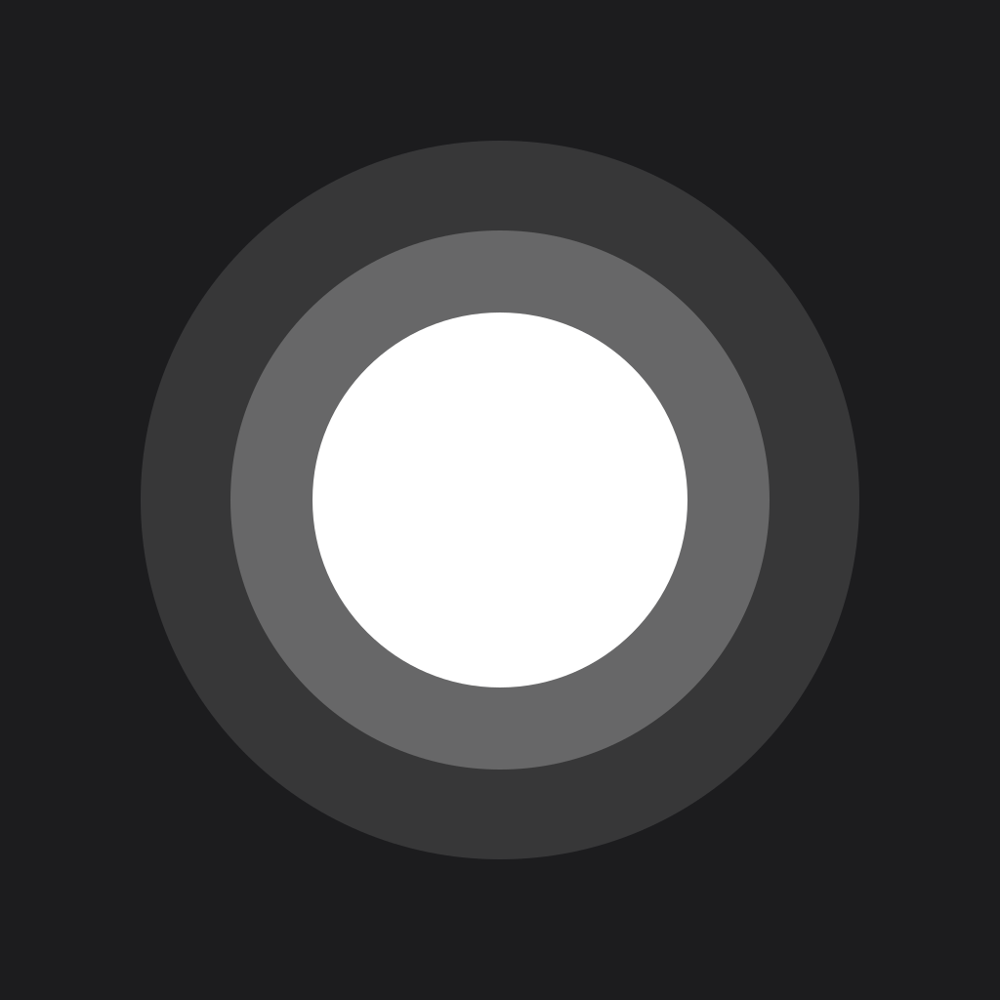
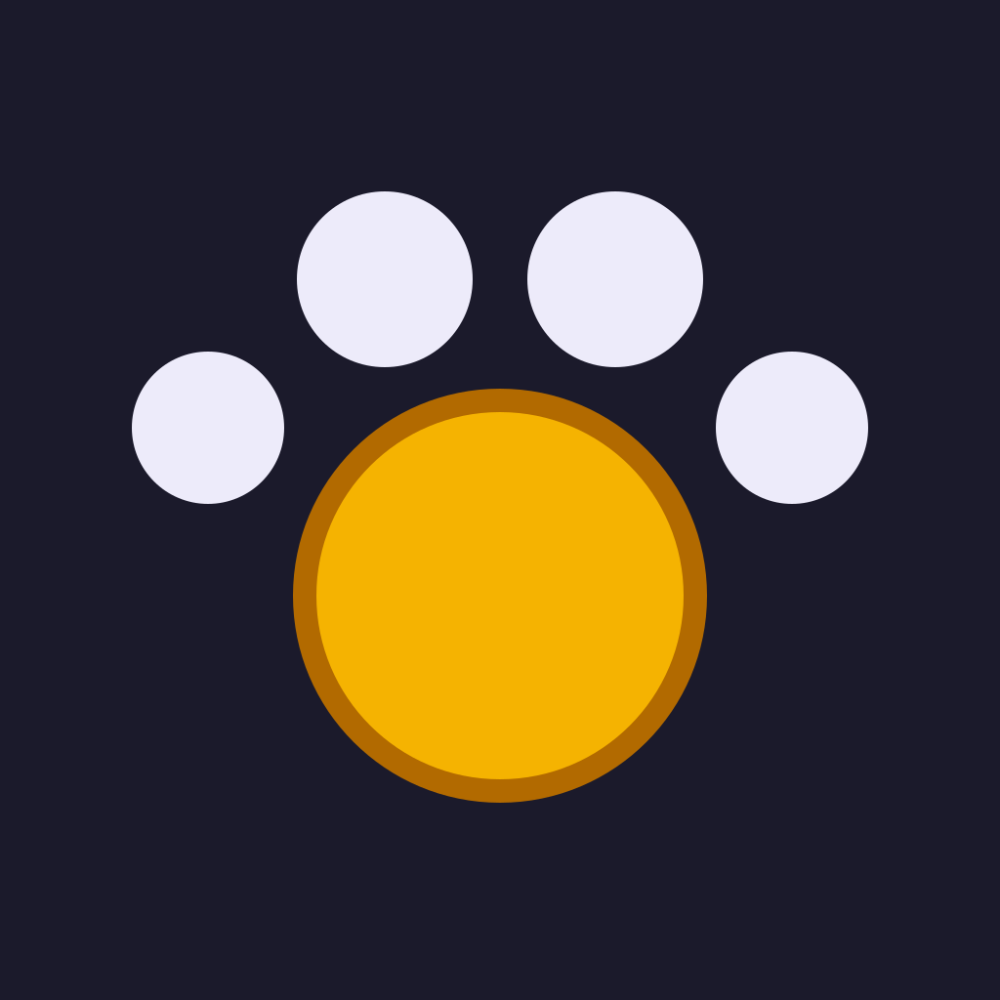
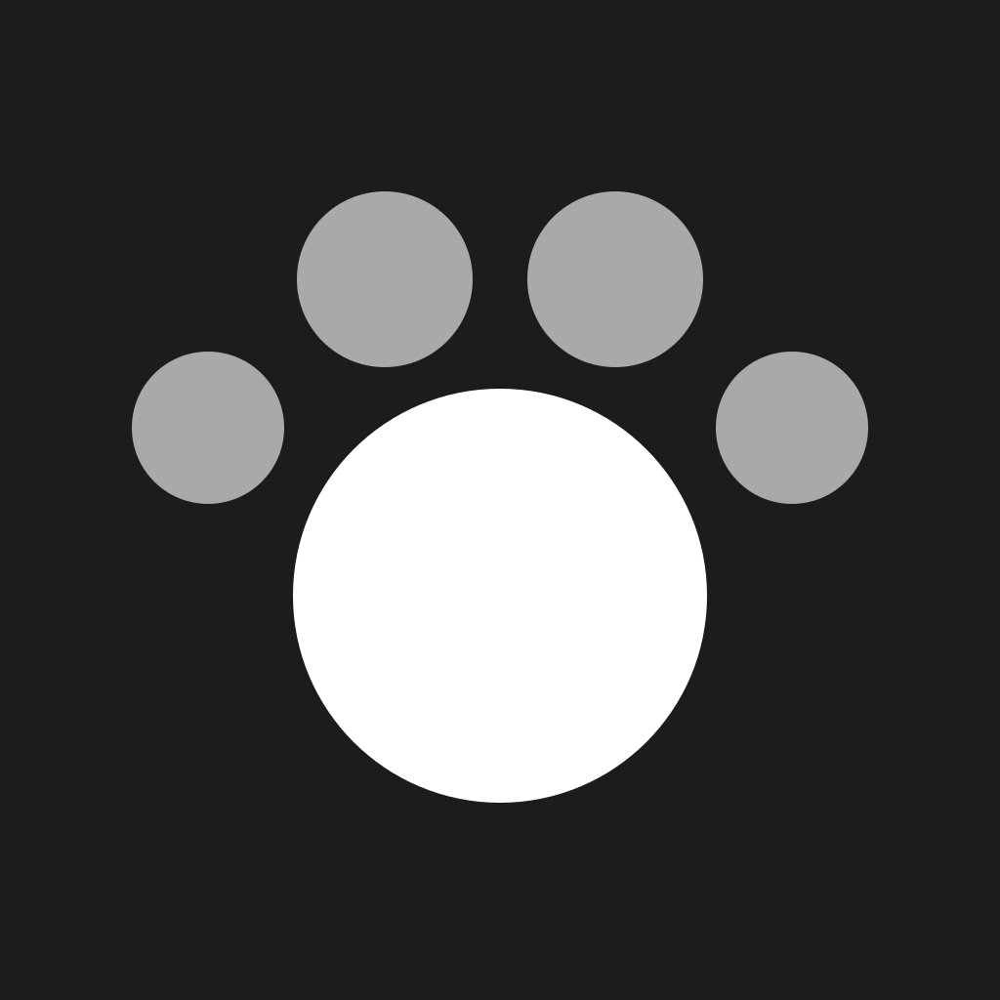
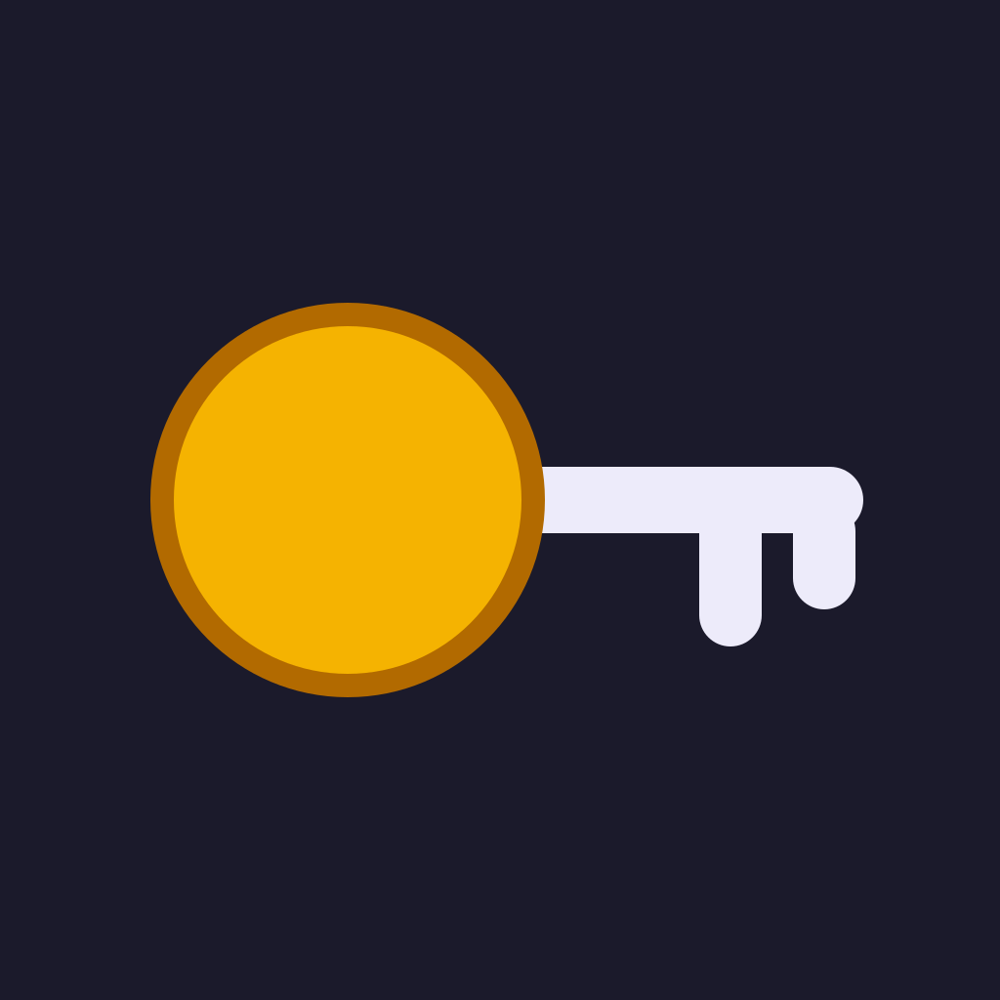
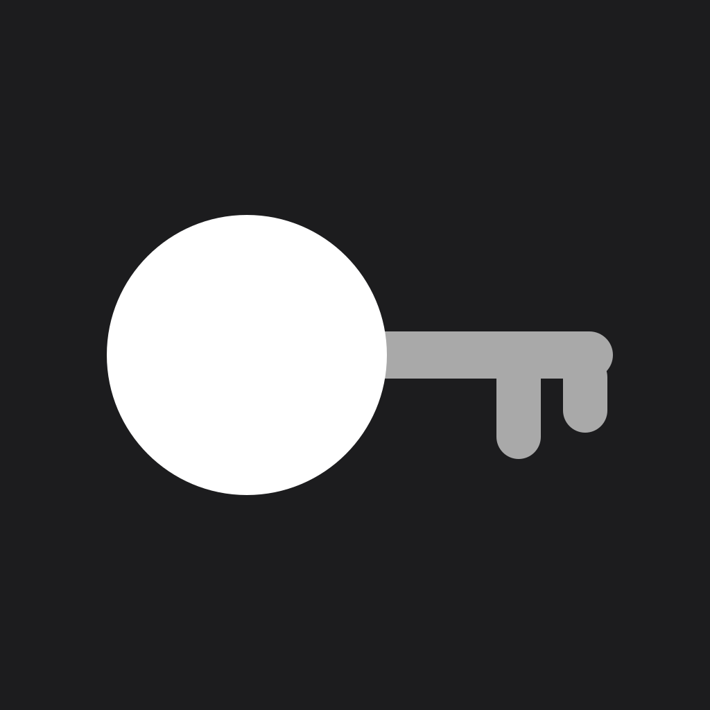
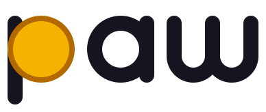

# paw design language

*First draft, 2026-11-22. Written for the owner to edit: change or delete anything that is not what you mean.*

This refines the approved "Keyring 2" direction into tokens and component specs that can be built in plain SwiftUI. It follows [principles.md](principles.md), above all "Be pleasant, not austere", "Say what happened and what to do" and "Say what is not protected". A visual version, with every swatch, component and logo drawn, is the private artifact "paw design language" (<https://claude.ai/artifact/DkVre97TrckNnmJ9ab4C3U>).

Colour figures are WCAG 2.2 contrast ratios computed by script from the hex values below, not estimates. Text needs 4.5:1; glyphs and other marks need 3:1. Sources and what could not be checked are at the end.

## 1. Character

| Adjective | In practice | Rules out |
|---|---|---|
| Friendly | Rounded titles, soft tinted chips, plain words, a little warmth in gold | Terminal looks, padlocks, shields, fear, a mascot |
| Native | System lists, sheets, bars, Liquid Glass and Dynamic Type, unrestyled | Custom navigation, custom fonts, tinted glass, a tab bar |
| Plain-spoken | Every state is a written sentence; limits are stated like benefits | Bare icons or coloured dots, "secure", "zero knowledge", raw git errors |
| One signal, one meaning | Gold is the key. Each colour and glyph has one job | Gold highlights, orange warnings, decorative colour on status |

## 2. Colour

### Decision: no accent colour

paw has one brand colour, gold, and it means the key. Ordinary interactive elements are ink: the single primary button on a screen is `onAction` on `action`, other buttons are `label` on `fill`, text buttons are `label` at semibold. Toolbar and search controls are untinted system glass, which is what Apple now asks for ("apply color sparingly"). System toggles stay green. A second hue would dilute the gold and crowd the folder tints.

### Neutrals and ink

Use the system colour in code; the hex is for reference. "Worst" is the lowest ratio over `bg`, `surface` and `surfaceRaised`.

| Token | Light | Dark | Role | Contrast |
|---|---|---|---|---|
| `bg` | #F2F2F7 | #000000 | `systemGroupedBackground` | |
| `surface` | #FFFFFF | #1C1C1E | Rows, cards: `secondarySystemGroupedBackground` | |
| `surfaceRaised` | #F2F2F7 | #2C2C2E | Inside sheets: `tertiarySystemGroupedBackground` | |
| `fill` | #767680 at 12% | #767680 at 24% | Pills, bars, secondary buttons: `tertiarySystemFill` | `labelSecondary` on it 5.2 / 4.5 |
| `separator` | system | system | Hairlines: `separator` | decoration |
| `label` | #000000 | #FFFFFF | Text: `.primary` | worst 18.8 / 13.9 |
| `labelSecondary` | #5C5C66 | #A9A8B6 | Subtitles, headers, footers. Custom: the system secondary label measures 3.3 on light `bg` | worst 5.9 / 5.9 |
| `labelTertiary` | #8B8A96 | #7E7D8A | Chevrons, placeholders. Never meaningful text | worst 3.0 / 3.4 |
| `action` / `onAction` | #1B1A2B / #FFFFFF | #F1F0F7 / #16151F | The one primary button, the current step pill | 17.1 / 16.0 |
| `panel` / `onPanel` | #1B1A2B / #FFFFFF | #26243A / #FFFFFF | Key status banner, copy confirmation | 17.1 / 15.0 |
| `onPanelSecondary` | #D4D2E4 | #D4D2E4 | Second line on `panel` | 11.5 / 10.1 |

For Increase Contrast, give `labelSecondary` #3F3E4C / #C9C8D6.

### The key gold

| Token | Value | Role | Contrast |
|---|---|---|---|
| `keyGold` | #F5B301 | Fill of the key disc, both themes | 1.7 light, 7.5 dark |
| `keyGoldRim` | #B26A00 | Ring around every disc | worst 3.8 light, 3.3 dark; 4.0 on `panel` |
| `keyGoldHalo` | #F5B301 at 24% (outer ring 12%) | Breathing rings while waiting for a touch | decoration |

Rules: gold is only ever the disc. Never text, a button, a folder, a warning or a highlight. Never draw the disc without its rim: on light grounds the fill alone is invisible to WCAG (1.7:1) and the rim carries it. The disc is flat: no glass, gradient or glyph.

### Status

Each status always comes with a glyph or a word. The three differ in lightness as well as hue.

| Token | Light | Dark | Role | Contrast (worst) |
|---|---|---|---|---|
| `success` | #005729 | #81F0A3 | Opened, copied, synced | 7.9 / 9.9 |
| `warning` | #AE4609 | #F99770 | Read before going on: tries left, no backup, recipients changed | 5.1 / 6.4 |
| `danger` | #A7002E | #F56B76 | Failed, locked, destructive | 7.0 / 4.8 |
| `warningFill` | #FFEADE | #381F11 | Warning banner; `warning` glyph on it 4.9 / 7.1 | `label` 18.1 / 15.3 |
| `dangerFill` | #FEE9E9 | #3B1C1D | Error banner, wrong-PIN field; `danger` glyph 6.7 / 5.3 | `label` 18.1 / 15.3 |

- `warning` is a red-orange on purpose. System orange is 7 to 9 OKLab units from the gold, too close to tell apart; this value is 10 or more away in both themes.
- **Not yet pushed** has no colour: `label` on `fill` with `arrow.up.circle`. It is not an error. It becomes `warning` only when a push was refused.
- **Face ID window open** has no colour: `label` on `fill` with `faceid` and the closing time. Green would claim protection it does not have, gold is the key's, red would scold a choice the person made.

### Password characters

| Token | Light | Dark | Role | Contrast (worst) |
|---|---|---|---|---|
| `passwordDigit` | #0038AB | #86B1FF | Digits | 8.7 / 6.5 |
| `passwordSymbol` | #BB378D | #FEBEE1 | Symbols; lighter than digits so they differ without hue | 4.7 / 9.1 |

### Folder tints

Each tint is a chip background and a glyph colour. The glyph is a mark, never text.

| Tint | Chip light | Glyph light | Chip dark | Glyph dark | Glyph on chip |
|---|---|---|---|---|---|
| blue | #E7EFFE | #003EB5 | #182846 | #B9D2FF | 7.7 / 9.6 |
| sky | #DFF2FC | #0C8BBB | #152C38 | #6DB5DA | 3.4 / 6.4 |
| teal | #E2F3F1 | #004744 | #182D2C | #8ACCC7 | 9.2 / 8.0 |
| olive | #EDF1E0 | #7B8935 | #272B18 | #B9C588 | 3.3 / 7.9 |
| purple | #F2EAFF | #52008D | #2E2140 | #A981E1 | 10.3 / 4.9 |
| magenta | #FFE7F2 | #C94893 | #3C1D2E | #D473A7 | 3.7 / 4.8 |
| cocoa | #F5EDE8 | #886650 | #302721 | #C0A593 | 4.5 / 6.3 |
| slate | #EDEEF1 | #595D69 | #28292C | #E0E4EF | 5.7 / 11.4 |

- **Assignment.** A top-level folder's tint is `FNV-1a 32-bit(lower-cased, NFC name) mod 7`, in the order blue, sky, teal, olive, purple, magenta, cocoa. Sub-folders and entries inherit it. `slate` is for entries in no folder. Do not use Swift's `Hasher`; it is seeded per launch. Two folders can share a tint; the name and glyph still tell them apart.
- **Excluded hues.** No gold, yellow, orange, red or green, so a chip never reads as the key or as a status. The nearest glyph to the gold is 23 units away in light and 11 in dark (olive; cocoa is 15).
- **Colour-blind check.** The glyph lightness was chosen by search to maximise the smallest difference under simulated protanopia, deuteranopia and tritanopia. The closest pair still lands near 7 units, visible side by side but not memorable. That is the ceiling for eight tints, so tint is never the only cue.

## 3. Typography

System fonts only, through Dynamic Type styles. No bundled font: SF is already rounded, monospaced and licensed for the app.

| Style | Default size/leading | Design, weight | Used for |
|---|---|---|---|
| `.largeTitle` | 34/41 | Rounded bold | Home title |
| `.title` | 28/34 | Rounded bold | Entry name, sheet and setup titles |
| `.title2` | 22/28 | Rounded bold | iPad column titles, empty states |
| `.title3` | 20/25 | Rounded semibold | Tries left, countdown numerals |
| `.headline` | 17/22 | Default semibold | Buttons, banner titles |
| `.body` | 17/22 | Default regular | Row names, field values |
| `.subheadline` | 15/20 | Default regular | Sheet text, bars |
| `.footnote` | 13/18 | Default regular; semibold for section headers | Subtitles, field labels, footers |
| `.caption` | 12/16 | Default regular | Step counter, large-type index. Nothing smaller |

- **Rounded** is for titles and key-sheet numerals. Never for row names, body text or passwords.
- **Passwords** use `Font.system(.body, design: .monospaced)` (SF Mono), with `.monospacedDigit()` for counts and times elsewhere. SF Mono draws a slashed zero and a footed 1, which separates 0/O and 1/l/I; colour (`passwordDigit`, `passwordSymbol`) backs that up. A large-type view shows one character per numbered cell at `.largeTitle` monospaced medium.
- **Line length.** Running text is at most 290pt wide in sheets, 340pt in setup and 560pt on iPad (roughly 45 to 75 characters). Row names are one line with tail truncation, two lines at accessibility sizes. A revealed password wraps by character and is never truncated.

## 4. Shape, spacing, elevation

- **Spacing scale:** 2, 4, 8, 12, 16, 24, 32 (`xxs` to `xxl`). Screen margin and row padding are 16.
- **Radii:** chip 8 on a 30pt chip (27% of the side, continuous); 14 for the 52pt chip, inline bars and the PIN field; 20 for custom cards and banners; capsule for buttons, pills and search. Native lists and sheets keep the system radius.
- **Sizes:** icon chip 30 (52 in the entry header) with a 16pt glyph; disc 14 / 36 / 92 with rims 1.5 / 2 / 3; rows at least 48 (one line), 56 (two lines), 64 (label over value); controls 50; touch targets at least 44. Wrap fixed sizes in `@ScaledMetric`.
- **Sheets:** the key prompt uses `.presentationDetents([.height(480), .large])`, moving to large while the keyboard is up. On iPad it is a centred form sheet about 420pt wide.
- **Elevation:** no shadows on content. Depth comes from the system.
- **Liquid Glass** is for the navigation layer only: the bottom search field and Add button, toolbar buttons, and sheets as the system draws them. No glass on rows, cards, banners or the disc; no tinted glass; no custom bar or sheet backgrounds.

## 5. Iconography

SF Symbols, one per concept. Every name below was checked against the SFSafeSymbols 7.0 name list.

| Concept | Symbol |
|---|---|
| Key needed, key present | The gold disc, never a symbol |
| Plug in the key | `cable.connector` (unplugged: `cable.connector.slash`) |
| Key locked | `lock.fill` in `danger` inside a `labelTertiary` ring |
| Face ID window | `faceid` |
| Folder | `folder.fill` |
| Entry, fallback glyph | `ellipsis.rectangle` |
| Copy | `document.on.document` (the old `doc.on.doc` is deprecated) |
| Reveal, hide | `eye`, `eye.slash` |
| Large type | `textformat.size.larger` |
| Synced | `checkmark.circle.fill` |
| Syncing | `arrow.trianglehead.2.clockwise.rotate.90` |
| Not yet pushed | `arrow.up.circle` |
| Offline | `wifi.slash` |
| Warning | `exclamationmark.triangle.fill` |
| Error | `exclamationmark.circle.fill` |
| Search, add, settings | `magnifyingglass`, `plus`, `slider.horizontal.3` |

Entry chips take a glyph from a small table bundled with the app, matched on the entry name, for example `envelope.fill`, `building.columns.fill`, `wifi`, `cart.fill`, `chevron.left.forwardslash.chevron.right`, `briefcase.fill`, `house.fill`, `airplane`. Nothing is fetched.

## 6. Motion and haptics

Three moments move. Everything else is system motion.

| Moment | Motion | Haptic | Reduce Motion |
|---|---|---|---|
| Waiting for touch | Two halo rings scale 0.9 to 1.04 and fade, 1.6 s ease-in-out, autoreversing, second ring 0.2 s behind | None while waiting | Rings hold still at full strength |
| Touch received | Disc shrinks to 0.6 and fades in 0.25 s; a `success` check springs in (response 0.35, damping 0.7); sheet closes after 1 s | `.success` | Cross-fade |
| Wrong PIN | Field shakes: 3 swings of 8pt in 0.4 s | `.error`; `.warning` when one try is left | Field turns `dangerFill` with no shake |

Other haptics, all through `sensoryFeedback`: copy is `.impact(weight: .light)`, "Lock now" is `.impact(flexibility: .rigid)`. Read `accessibilityReduceMotion` from the environment.

## 7. Components

Each is drawn in every state in the artifact.

| Component | Anatomy and sizes | Tokens | States | VoiceOver |
|---|---|---|---|---|
| Entry row | Chip 30, name `.body`, subtitle `.footnote`, trailing mark; min 56 | tint pair, `label`, `labelSecondary` | Opens with Face ID (`faceid`); needs key (14pt disc); search match in semibold | "Fastmail, email, needs your key" |
| Folder row | Chip with `folder.fill`, name, count, chevron; min 48 | tint pair, `labelSecondary`, `labelTertiary` | Normal; selected (system style on iPad) | "bank, folder, 9 passwords" |
| Section header | `.footnote` semibold, 16 inset, sentence case | `labelSecondary` | | Heading trait |
| Gold disc | Circle with rim; 14, 36, 92 | `keyGold`, `keyGoldRim`, `keyGoldHalo` | Still (needed); breathing (waiting); gone (done); grey ring with lock (locked) | Marker: "Needs your key". Hero: hidden |
| Key prompt sheet | Grabber, hero disc, `.title` rounded, one or two `.subheadline` sentences, three step pills, buttons | `surface`, `action`, `success`, `danger`, `dangerFill` | Plug in; PIN; touch; success; wrong PIN with tries left in `.title3` rounded; locked (no gold, says what unlocks it and what still works) | Announce each change: "Wrong PIN. 2 tries left before the key locks." |
| Password field | Label `.footnote` over value; eye and copy at 44; min 64 | `label`, `passwordDigit`, `passwordSymbol` | Hidden (always 16 dots); shown; large type | "Password, hidden". Large type: "Capital O, 9 of 12" |
| Copy confirmation | Capsule, check, one sentence; 2 s | `panel`, `onPanel` | Secret (says when it clears); not secret | Announcement, not focusable |
| Bottom search and Add | Search capsule and round Add, 50 high, system glass: `DefaultToolbarItem(kind: .search, placement: .bottomBar)`, `ToolbarSpacer`, button | system | Resting; searching (Add becomes close) | "Search passwords", "Add a password" |
| Sync pill | 30pt capsule, 14pt glyph, `.footnote` | `fill`, `success`, `warningFill` | Synced; syncing; not pushed; offline; failed | "Sync status: 1 change not pushed" |
| Unpushed banner | Card radius 20, leading mark, title, one line; not dismissable | `surface`, `warningFill` | Waiting for key (36pt disc); offline; refused | Title and line as one element |
| Face ID window bar | 44pt bar, `faceid`, closing time, "Lock now" | `fill`, `label` | Open; absent when closed | "Opens with Face ID until 6:40 PM. Lock now, button" |
| Empty state | `ContentUnavailableView`: 52pt slate chip, `.title2` rounded, one or two sentences, up to two buttons | `labelSecondary`, `action` | No passwords; no matches | Title, sentence, buttons |
| Error row | 22pt glyph, `.body` problem, `.footnote` next step, one action | `danger`, `warning`, fills | Error; warning; banner | "Error: Couldn't reach your git remote…" |
| Setup step | "Step 2 of 5", `.title` rounded, two sentences, illustration, "Not protected" card, one button | `surface`, `action` | Per step | Counter read with the heading |

## 8. Voice

- Sentence case everywhere. No exclamation marks, no emoji.
- Say "you" and "your key". Name the problem, then the next step.
- Use exact numbers and times.
- Say "password", "folder", "key", "git remote". Avoid "vault", "credential", "authenticate", "decrypt".
- Say what still works, and what is not protected, in the same plain words as the benefits.

| Before | After |
|---|---|
| Authentication Required | Touch your key |
| Invalid PIN (0x6982) | Wrong PIN. 2 tries left before the key locks. |
| Card blocked | Your key is locked. Unlock it with the key's reset code or Admin PIN. |
| No device detected | Plug in your key |
| Unlocked | Opens with Face ID until 6:40 PM |
| Copied! | Password copied. Clears in 45 seconds. |
| fatal: unable to access remote | Couldn't reach your git remote. Passwords on this iPhone still work. |
| 1 unpushed commit | 1 change is only on this iPhone |
| Your vault is secured with zero-knowledge encryption | Entry names and folder names are not encrypted. Anyone who can read your git repository can see them. |
| .gpg-id modified | A new key can now open your passwords |

One change from the mock-ups: "the gold part of your key" instead of "the gold disc on your YubiKey", because some YubiKey models have gold edges, not a disc.

## 9. Logo and app icon

Three icon candidates and a wordmark. Sources are in [design/](design/); each has a `-mono` version showing what tinted and clear icon modes keep.

| | Colour | Mono | Assessment |
|---|---|---|---|
| A. Gold disc |  |  | The mark the app already uses. Clear at 29, 60 and 1024, and Apple's own example of a good icon is a light disc on a dark one. But in monochrome it is only a dot, and a gold disc alone also says coin. Lowest trademark risk. |
| B. Paw of discs |  |  | The large pad is the key disc; the toes read as four fingertips reaching for it. Still a paw in monochrome; toes are 5pt across at 29pt. Risks: paw prints are common in pet apps, and it dies if the name changes. No claws and no tilt keeps it away from the Jack Wolfskin mark. |
| C. Key with a disc bow |  |  | Says "passwords" fastest. The shaft thins to 2pt at 29pt, and keys are what every password app draws, Apple Passwords included. |

Wordmark, for the README and the About screen, never the icon (Apple: include text only when essential):

 

It is drawn from circles and round-capped strokes, not set in SF Rounded, because Apple's font licence does not cover logos. The bowl of the p is the key disc.

**Recommendation: B**, with A as the fallback. B is the only candidate that is friendly, specific to this app and still itself in monochrome, and it reuses the one object the app teaches: the gold disc. It avoids the padlock and shield entirely.

**Shipping it without a Mac.** Icon Composer is Mac-only and its `.icon` format is undocumented, but Apple still accepts plain 1024 px PNGs in the asset catalog (default, dark and tinted) and generates the glass and clear variants itself. Render the SVGs to PNG in CI.

## 10. SwiftUI token sketch

```swift
import SwiftUI
import UIKit

enum PawColor {
    // System
    static let bg = Color(.systemGroupedBackground)
    static let surface = Color(.secondarySystemGroupedBackground)
    static let surfaceRaised = Color(.tertiarySystemGroupedBackground)
    static let fill = Color(.tertiarySystemFill)
    static let label = Color.primary
    // Custom
    static let labelSecondary = dyn(0x5C5C66, 0xA9A8B6)
    static let labelTertiary = dyn(0x8B8A96, 0x7E7D8A)
    static let action = dyn(0x1B1A2B, 0xF1F0F7)
    static let onAction = dyn(0xFFFFFF, 0x16151F)
    static let panel = dyn(0x1B1A2B, 0x26243A)
    static let onPanelSecondary = Color(hex: 0xD4D2E4)
    static let keyGold = Color(hex: 0xF5B301)      // the key disc only
    static let keyGoldRim = Color(hex: 0xB26A00)
    static let success = dyn(0x005729, 0x81F0A3)
    static let warning = dyn(0xAE4609, 0xF99770)
    static let danger = dyn(0xA7002E, 0xF56B76)
    static let warningFill = dyn(0xFFEADE, 0x381F11)
    static let dangerFill = dyn(0xFEE9E9, 0x3B1C1D)
    static let passwordDigit = dyn(0x0038AB, 0x86B1FF)
    static let passwordSymbol = dyn(0xBB378D, 0xFEBEE1)

    static func dyn(_ light: UInt32, _ dark: UInt32) -> Color {
        Color(UIColor { $0.userInterfaceStyle == .dark ? UIColor(hex: dark) : UIColor(hex: light) })
    }
}

enum PawTint: Int, CaseIterable {
    case blue, sky, teal, olive, purple, magenta, cocoa, slate

    /// Stable across launches and devices. Entries in no folder pass nil.
    init(folder: String?) {
        guard let folder else { self = .slate; return }
        var hash: UInt32 = 2_166_136_261
        for byte in folder.lowercased().precomposedStringWithCanonicalMapping.utf8 {
            hash = (hash ^ UInt32(byte)) &* 16_777_619
        }
        self = PawTint(rawValue: Int(hash % 7))!
    }

    var chip: Color { PawColor.dyn(values.0, values.2) }
    var glyph: Color { PawColor.dyn(values.1, values.3) }

    private var values: (UInt32, UInt32, UInt32, UInt32) {
        switch self {
        case .blue: (0xE7EFFE, 0x003EB5, 0x182846, 0xB9D2FF)
        case .sky: (0xDFF2FC, 0x0C8BBB, 0x152C38, 0x6DB5DA)
        case .teal: (0xE2F3F1, 0x004744, 0x182D2C, 0x8ACCC7)
        case .olive: (0xEDF1E0, 0x7B8935, 0x272B18, 0xB9C588)
        case .purple: (0xF2EAFF, 0x52008D, 0x2E2140, 0xA981E1)
        case .magenta: (0xFFE7F2, 0xC94893, 0x3C1D2E, 0xD473A7)
        case .cocoa: (0xF5EDE8, 0x886650, 0x302721, 0xC0A593)
        case .slate: (0xEDEEF1, 0x595D69, 0x28292C, 0xE0E4EF)
        }
    }
}

enum PawFont {
    static let homeTitle = Font.system(.largeTitle, design: .rounded, weight: .bold)
    static let title = Font.system(.title, design: .rounded, weight: .bold)
    static let columnTitle = Font.system(.title2, design: .rounded, weight: .bold)
    static let numeral = Font.system(.title3, design: .rounded, weight: .semibold)
    static let sectionHeader = Font.footnote.weight(.semibold)
    static let password = Font.system(.body, design: .monospaced)
    static let passwordLarge = Font.system(.largeTitle, design: .monospaced, weight: .medium)
}

enum PawMetrics {
    static let spacing: (xxs: CGFloat, xs: CGFloat, s: CGFloat, m: CGFloat, l: CGFloat, xl: CGFloat, xxl: CGFloat)
        = (2, 4, 8, 12, 16, 24, 32)
    static let chip: CGFloat = 30, chipLarge: CGFloat = 52, chipRadiusRatio: CGFloat = 0.27
    static let discMarker: CGFloat = 14, discBanner: CGFloat = 36, discHero: CGFloat = 92
    static let rowOneLine: CGFloat = 48, rowTwoLine: CGFloat = 56, rowField: CGFloat = 64
    static let control: CGFloat = 50, tapMin: CGFloat = 44
    static let inlineRadius: CGFloat = 14, cardRadius: CGFloat = 20
    static let sheetTextWidth: CGFloat = 290, readableWidth: CGFloat = 560
}
```

`Color(hex:)` and `UIColor(hex:)` are two small initialisers to add. The sketch has not been compiled.

## 11. Open questions for the owner

1. **Accent.** Stay with ink and no accent, or add an indigo accent for buttons and links? *Default: ink, so gold stays the only brand colour.*
2. **Icon and name.** Paw of discs, or the plain disc? An app named "Paw" already exists on the App Store, so the listing needs a qualified name. *Default: the paw, listed as "paw for pass".*
3. **Tint assignment.** Hash only, or let people choose a folder's tint? A choice would have to live on the device, since the store takes no paw-only files. *Default: hash only for now.*
4. **Cocoa and olive.** They are the tints closest to gold in dark mode (15 and 11 units; the rest are 20 or more). Keep eight tints or drop to six? *Default: keep eight; look at them on a device first.*
5. **Entry glyphs.** Match a glyph from a bundled name table, or give every entry its folder's glyph? *Default: the table, about forty names, no network.*
6. **Secondary text.** Keep the custom `labelSecondary`, or accept the fainter system colour for a fully stock look? *Default: custom; subtitles here carry security information.*

## Sources and limits

- Apple Human Interface Guidelines: [Color](https://developer.apple.com/design/human-interface-guidelines/color), [Typography](https://developer.apple.com/design/human-interface-guidelines/typography), [Materials](https://developer.apple.com/design/human-interface-guidelines/materials), [Toolbars](https://developer.apple.com/design/human-interface-guidelines/toolbars), [Search fields](https://developer.apple.com/design/human-interface-guidelines/search-fields), [SF Symbols](https://developer.apple.com/design/human-interface-guidelines/sf-symbols), [App icons](https://developer.apple.com/design/human-interface-guidelines/app-icons); [Adopting Liquid Glass](https://developer.apple.com/documentation/technologyoverviews/adopting-liquid-glass); [Icon Composer](https://developer.apple.com/icon-composer/).
- Symbol names: [SFSafeSymbols](https://github.com/SFSafeSymbols/SFSafeSymbols) 7.0.
- Contrast: [WCAG 2.2](https://www.w3.org/TR/WCAG22/#contrast-minimum), 1.4.3 and 1.4.11. APCA was not used: it is not part of WCAG 2.2, and the WCAG 3 draft has not chosen an algorithm. Colours were built in OKLCH ([oklch.com](https://oklch.com)); colour-blind simulation uses the Machado 2009 matrices.
- Lessons borrowed from other apps: one brand hue with status kept separate ([Bitwarden](https://bitwarden.com/en-gb/brand.md)); design the mark at form-field size first ([Proton Pass](https://proton.me/blog/pass-logo-story)); warmth beside the brand colour, no scare tactics ([1Password](https://1password.com/blog/1password-brand-refresh)); one signature control carries the identity ([Things](https://culturedcode.com/things/blog/2025/09/things-for-os-26/)); borrow a real-world convention for rows ([Flighty](https://developer.apple.com/news/?id=970ncww4)); hierarchy by visual weight ([Halide](https://lux.camera/halide-mark-iii/)).
- Trademark notes are research, not legal advice: [Yubico's terms](https://yubico.com/support/terms-conditions/yubico-website-terms-conditions) claim its names and graphics, so write "YubiKey" only descriptively and never draw its logo; Jack Wolfskin's paw disputes are documented [here](https://netzpolitik.org/2009/abwahnsinn-jack-wolfskin-mahnt-bastelcommunity-ab/).
- **Not verified:** anything on a real device (SF Rounded and SF Mono shapes, glass, the dark-mode look of the tints); the exact values of system `label`, `separator` and background colours on iOS 26, which Apple does not publish; iOS 27 API changes; whether deprecated symbol names still resolve; whether a hand-written `.icon` file compiles in CI; other apps' haptics and empty states, which their makers do not document.

## Implementation notes

*Added 2026-11-22 with the first build of the tokens and components (`app/Shared/Design/`), checked on an iPhone 17 simulator running iOS 26 in CI.*

- **Where to look.** Launch a debug build with `-pawGallery 1` for every component in every state; add `-pawGalleryPage home` (or `colours`, `type`, `tints`, `symbols`, `rows`, `disc`, `sheet`, `entry`, `status`, `empty`) and `-pawAppearance dark|light`. `app/PawUITests/GalleryTests.swift` photographs each page in both themes.
- **Section 10 compiles** with small changes: the tint enum is `FolderTint` and falls back to slate instead of force-unwrapping; spacing is `PawMetrics.Spacing.l` rather than a tuple; `labelSecondary` also carries the Increase Contrast values.
- **Symbols.** All sixteen names in section 5 and the entry glyphs resolve on iOS 26; the gallery's Symbols page fails its test if one ever stops resolving. `textformat.size.larger` draws as a plain capital A at row size, which does not say "large type" on its own.
- **Tint rule.** The FNV-1a assignment matches values worked out independently: bank cocoa, dev blue, email sky, home teal, shopping olive, and "café" gets the same tint composed or decomposed.
- **Fixed sizes and Dynamic Type.** Chips and the small discs scale with `@ScaledMetric` but stop at 1.5 times, so that at the largest text sizes the width goes to the name. Row names get three lines at accessibility sizes, not two: two lines cut "Checking account" short at the largest size.
- **Home title.** The mock Home draws "Passwords" as rounded large-title text in the list, under a system toolbar that holds only the settings button, because a navigation bar title cannot be set in SF Rounded without UIKit appearance overrides. It does not collapse into the bar on scroll.
- **Not-yet-pushed banner.** Waiting for the key is drawn on `panel` with the 36pt disc, as in the Keyring 2 mock-up; offline is on `surface`; refused is on `warningFill`. Section 7 lists only `surface` and `warningFill`.
- **Touch stage.** The hero is the 92pt disc with its halo inside a thin outline of a key, following design.md 2.3 ("the gold disc glyph alone is never used as the touch prompt"). The halo reaches 1.74 times the disc, not the mock-up's 1.91, so the stage fits the 480pt detent. The 15-second ring is not built.
- **PIN stages** use the 36pt disc so the field and both buttons stay above the keyboard.
- **Bottom search.** The system search field's VoiceOver label is the prompt ("Search 332 passwords"), not "Search passwords". While searching, the system replaces Add with its own close button.
- **Copy confirmation** is hidden from VoiceOver focus and posted as an announcement, as specified, so UI tests can only see it in screenshots.
